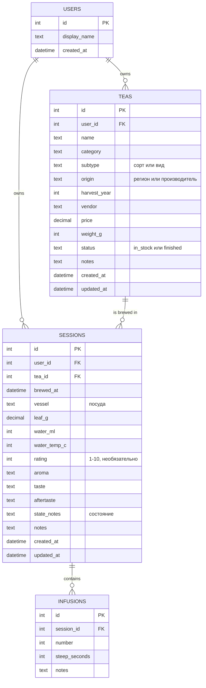

# Модель данных

Черновик v0.1. Схема будет уточняться при создании первой миграции (этап 1).

## ER-диаграмма

## Решения и обоснование

**Подготовка к аккаунтам.** Таблица `users` создаётся сразу, а `teas` и `sessions` ссылаются на неё через `user_id`. В MVP в `users` лежит одна запись (владелец), и API подставляет её автоматически. Когда понадобится авторизация, добавятся поля вроде `email` и `password_hash`, а существующие данные уже будут привязаны к владельцу. Проще заложить связь сейчас, чем добавлять её миграцией в готовые таблицы.

**Оценка.** Хранится целым числом от 1 до 10, а на экране делится на 2 и показывается звёздами с половинками (7 → 3,5★). Целые числа удобнее сравнивать и усреднять, чем дробные, и нет проблем с точностью. В БД стоит ограничение `CHECK (rating BETWEEN 1 AND 10)`, значение `NULL` означает «не оценено».

**Проливы отдельной таблицей.** Число проливов у сессии разное, поэтому они вынесены в `infusions` со связью «один ко многим». Пара `(session_id, number)` должна быть уникальной.

**Категория чая** хранится текстом из ограниченного набора (улун, белый, пуэр, зелёный, красный, другое). Конкретный сорт, например Да Хун Пао или Шоу Мэй, записывается свободным текстом в `subtype`. Так фильтрация по категориям остаётся простой, а сортов можно вводить сколько угодно.

**Удаление.** При удалении чая удаляются и его сессии, а при удалении сессии её проливы (`ON DELETE CASCADE`). В интерфейсе перед удалением чая нужно показывать подтверждение.

**Время.** `brewed_at` вводится вручную (FR-7). Служебные `created_at` и `updated_at` заполняются автоматически.

## Открытые вопросы

- Нужно ли поле «примерная дата» для старых бумажных заметок, где точной даты нет?
- Хранить ли температуру и вес как число или как диапазон (например, 95–100 °C)?
- Нужен ли отдельный справочник посуды вместо свободного текста?
