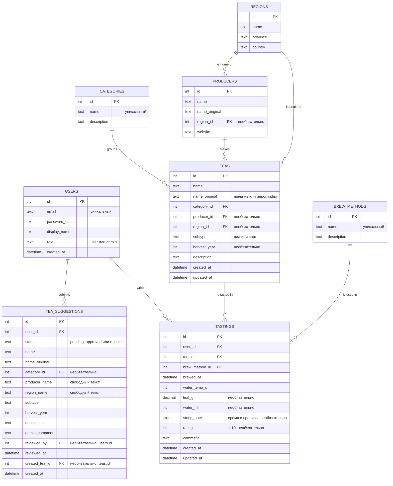

# Модель данных (v0.2)

Черновик. В голове появился образ конечного продукта. 
Заменяет версию v0.1: каталог чаёв теперь общий, добавлены аккаунты с ролями, справочники и предложения новых чаёв. В MVP 8(восемь) таблиц.

## ER-диаграмма

## Назначение таблиц

| Таблица | Что хранит | Кто редактирует |
|---------|------------|-----------------|
| `users` | Аккаунты, хеш пароля, роль | Сам пользователь, администратор |
| `categories` | Категории чая: улун, белый, пуэр, зелёный, красный и т. д. | Администратор |
| `regions` | Регионы происхождения | Администратор |
| `producers` | Производители (фабрики, плантации, бренды) | Администратор |
| `teas` | Каталог чаёв | Администратор |
| `brew_methods` | Способы заваривания (гунфу-ча, европейский, холодный настой…) | Администратор |
| `tastings` | Дегустации пользователей: способ, температура, оценка, комментарий | Автор дегустации |
| `tea_suggestions` | Предложения новых чаёв и их статус | Автор (создаёт), администратор (рассматривает) |

## Решения и обоснование

**Каталог общий, личное отдельно.** В v0.1 у чая были цена, вес и продавец, потому что чай был личным. Теперь `teas` описывает сам чай и принадлежит всем, а то, что делает конкретный пользователь, лежит в `tastings`. Цена и продавец из модели убраны. Если понадобятся, их можно вернуть в виде «моей коллекции».

**Оценка в каждой дегустации.** Один чай по-разному раскрывается при разных способах заваривания, поэтому оценка хранится в `tastings`. Средняя оценка чая считается запросом (`AVG(rating)` по дегустациям этого чая) и в БД не хранится. Оценка хранится целым числом от 1 до 10 с ограничением `CHECK (rating BETWEEN 1 AND 10)` и показывается в интерфейсе звёздами (значение делится на 2). `NULL` означает «без оценки».

**Справочники вместо текстовых полей.** Категории, регионы, производители и способы заваривания вынесены в отдельные таблицы. Это убирает неточности ("Улун" и "улун") и делает фильтры надёжными.

**Время и проливы.** Таблицы проливов в MVP нет: достаточно необязательного поля `steep_note`. Если понадобится подробнее, таблицу `infusions` можно вернуть позже.

**Предложения.** Производитель и регион в `tea_suggestions` хранятся текстом, потому что пользователь может предложить чай с производителем, которого ещё нет в справочнике. При одобрении администратор сопоставляет текст со справочником (или создаёт новую запись) и создаёт чай; ссылка на него сохраняется в `created_tea_id`.

**Роли.** Роль хранится в поле `users.role` (`user` или `admin`), отдельная таблица ролей в MVP не нужна. Права проверяются на сервере, а не только в интерфейсе. Пароли хранятся только в виде хеша.

**Удаление.**
- Запись справочника или чай, на которые есть ссылки, удалять нельзя (`ON DELETE RESTRICT`).
- При удалении пользователя удаляются его дегустации и предложения (`ON DELETE CASCADE`).

## Следующий слой (после MVP)

- `tags` и связь с чаем или дегустацией (см. открытые вопросы в ТЗ).
- `collections` и `collection_items`: коллекции чаёв пользователя.
- `infusions`: проливы, если понадобятся.

## Открытые вопросы

- Уникальность чая: достаточно ли пары `(name, producer_id, harvest_year)`, чтобы не допускать дубликатов в каталоге?
- Нужна ли иерархия регионов (провинция → район) или хватит двух текстовых полей?
- Один пользователь может оставить несколько дегустаций одного чая с одним и тем же способом заваривания?